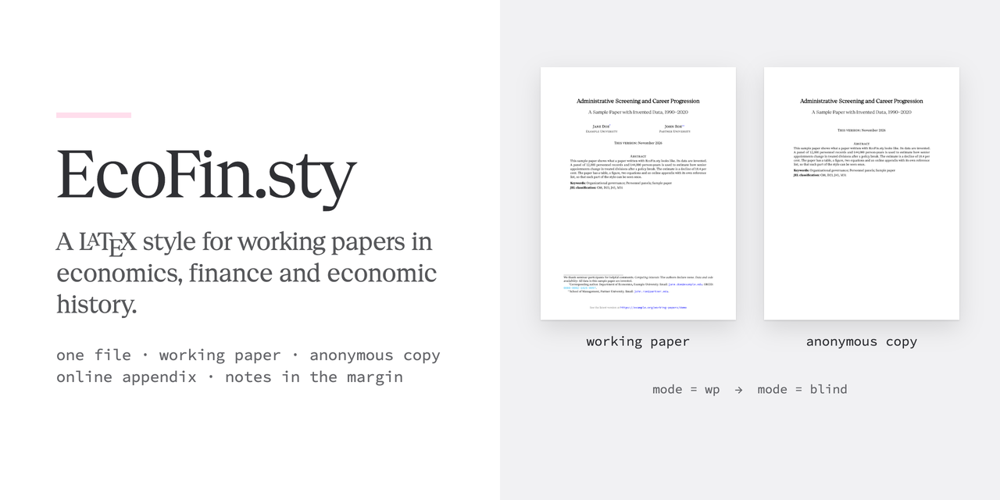
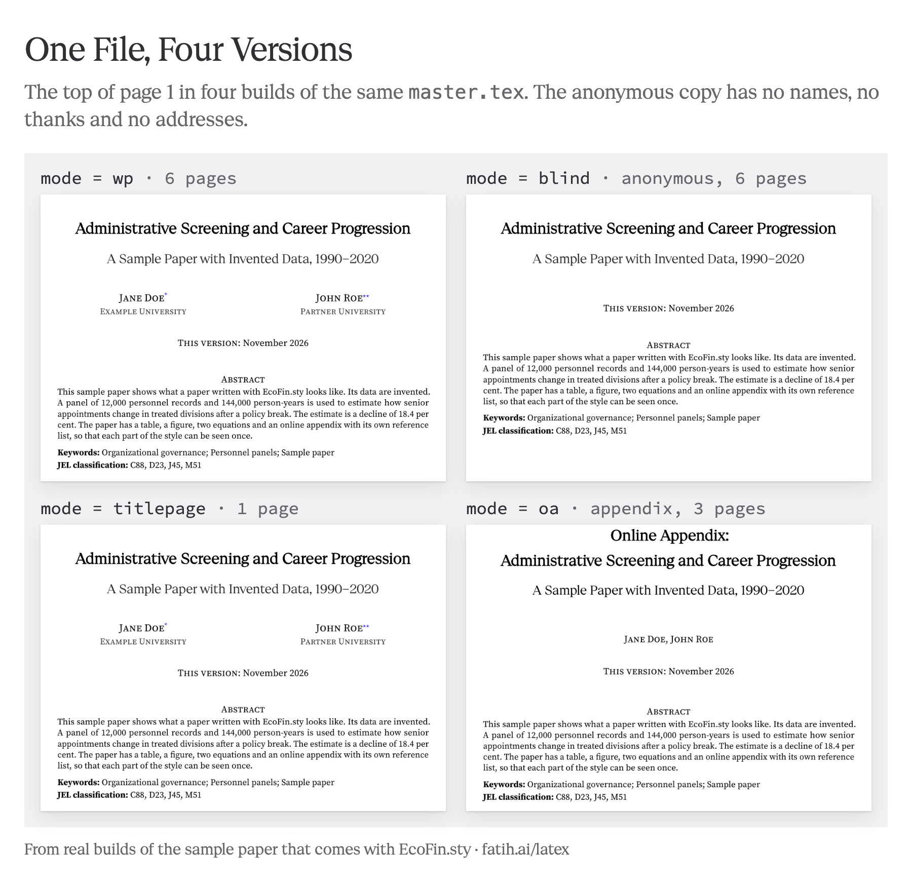
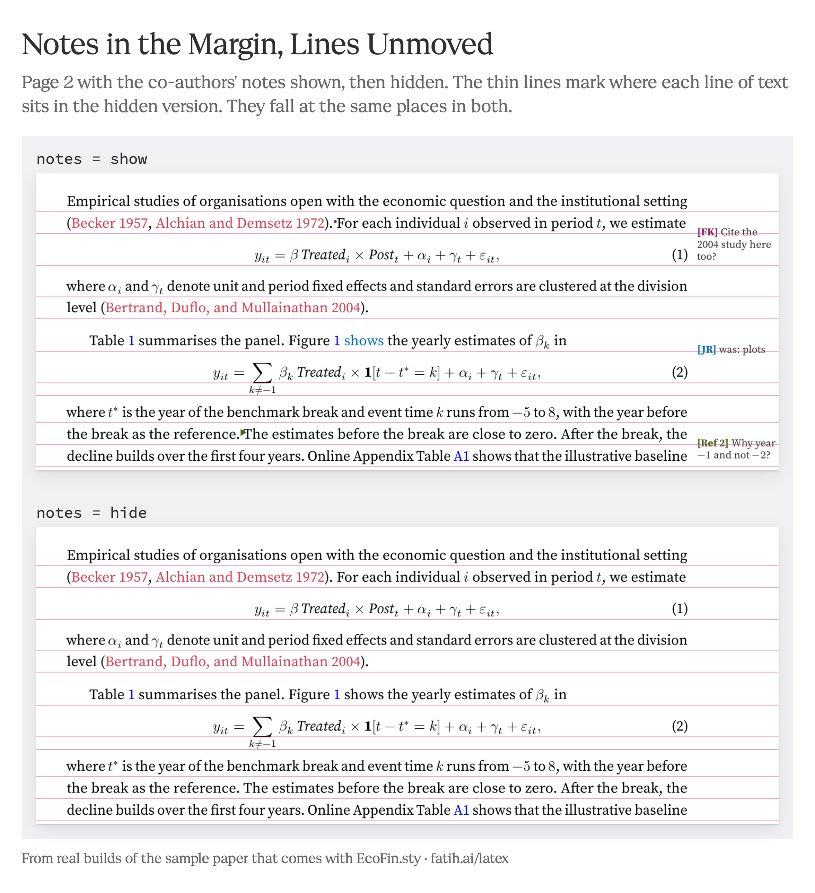
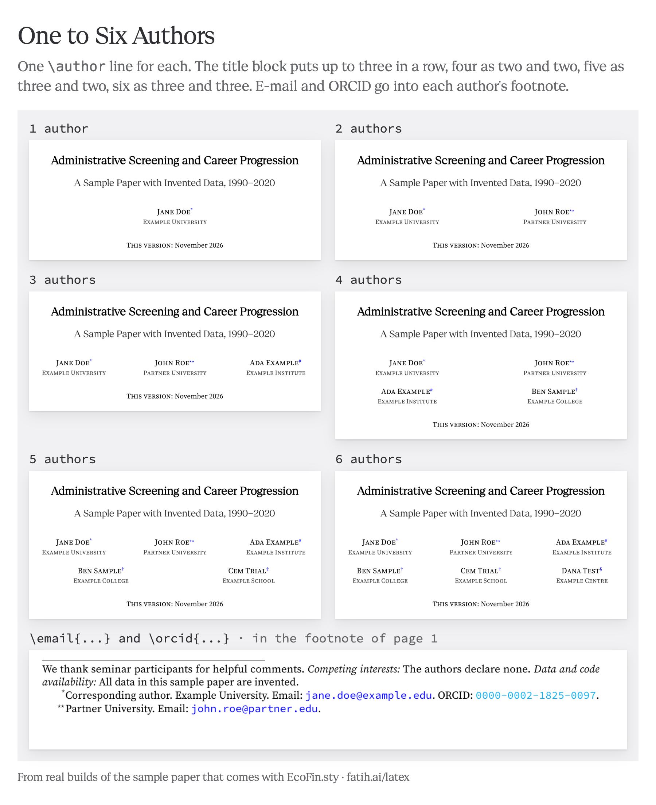
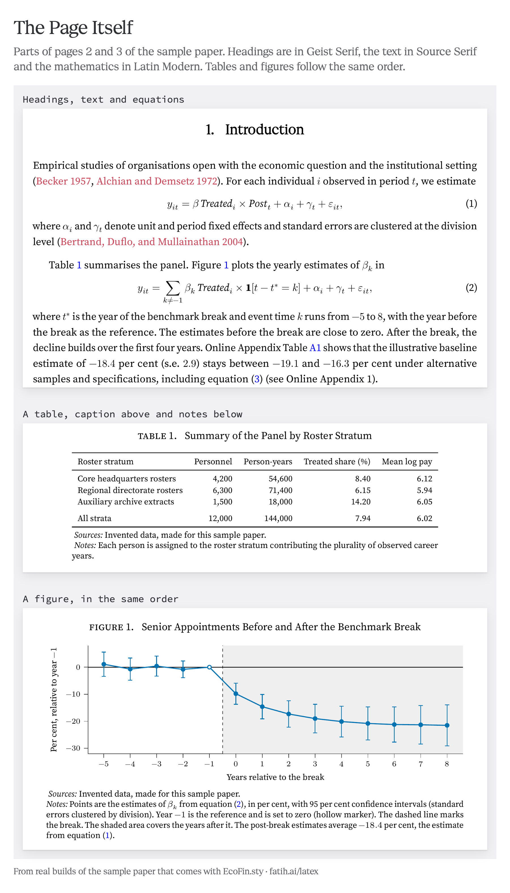
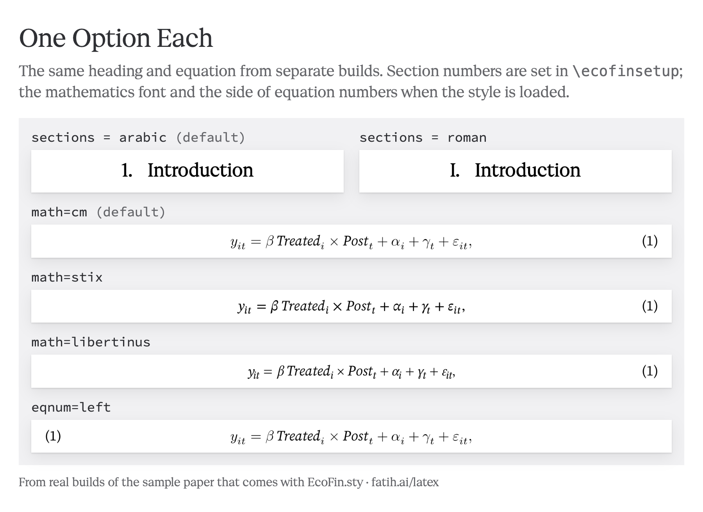
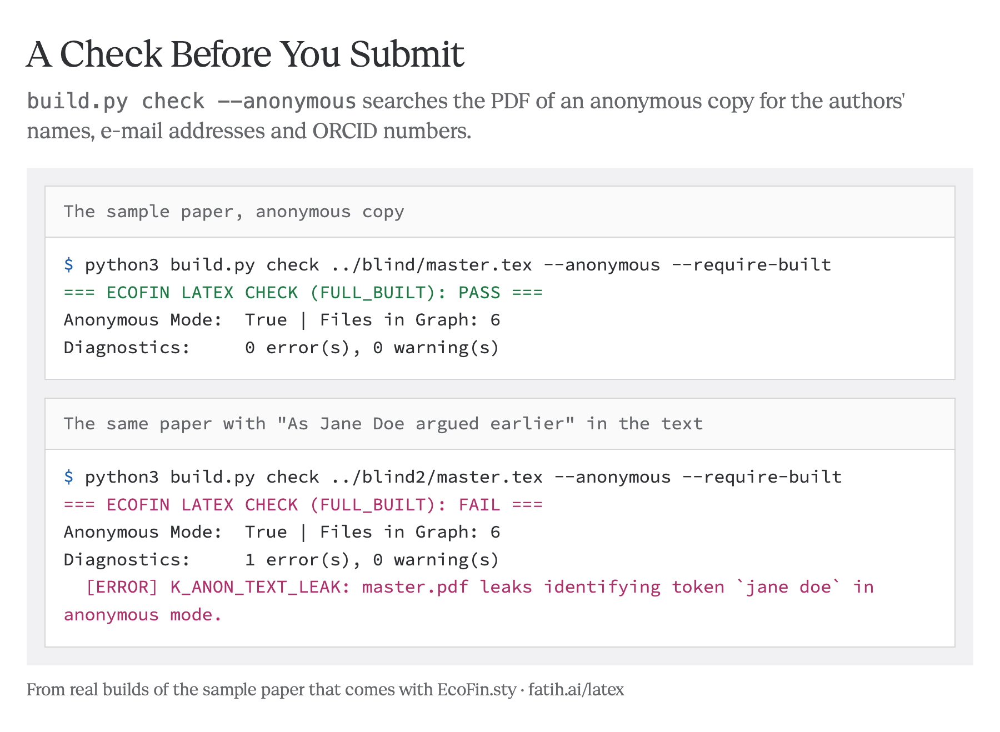

<p align="center"></p>

<p align="center">
<a href="https://fatih.ai/latex/"><b>Project page</b></a> ·
<a href="https://github.com/kansoy/EcoFin.sty/releases/latest"><b>Download</b></a> ·
<a href="sample/master.pdf">Sample paper (PDF)</a> ·
<a href="#start">Start</a> ·
<a href="#settings">Settings</a>
</p>

EcoFin.sty is a LaTeX style for working papers in economics, finance and economic history. From one `master.tex` it builds the working paper, the anonymous copy for referees, the title page and the online appendix. Co-authors can write their comments in the margin of the same file. One setting removes them again.

Each video below lasts 60 seconds and has no sound. The videos and the figures were made from real builds of the sample paper in [`sample/`](sample/).

## What It Does

### One File, Every Version

One word in `\ecofinsetup` decides which version comes out of the file. The anonymous copy leaves out the names, the thanks, the e-mail addresses and the ORCID. The author field of the PDF is empty as well. A single command writes the three files that journal sites ask for.



https://github.com/user-attachments/assets/805760dd-deb9-4287-b3c9-148ca26cb93b

More in [Modes](#modes).

### Comments in the Margin, On or Off

`\mnote` leaves a note beside a sentence, `\discuss` raises a question and `\replace` proposes new wording. With `notes = show` the notes stand in the margin. With `notes = hide` the text is printed alone, broken into exactly the same lines. An anonymous copy never shows the notes.



https://github.com/user-attachments/assets/e19f98b9-b1c2-4ab7-bda1-1d5647ba457a

More in [Comments in the Margin](#comments-in-the-margin).

### Add an Author, Hide a Section

Each author takes one line in `master.tex`. The title block places one to six authors by itself, while `\email` and `\orcid` go into each author's footnote. A section, a block of text or the whole online appendix can be switched off without deleting it. The contents list follows these switches.



https://github.com/user-attachments/assets/de6fc098-1071-48ca-a159-4ad1f5e4ac13

More in [Title Page](#title-page) and [Sections On and Off](#sections-on-and-off).

### The Page Itself

The headings are set in Geist Serif, the text in Source Serif and the mathematics in Latin Modern. Citations are brick red and links are blue. Tables and figures have their caption above and their notes below. STIX Two or Libertinus mathematics, equation numbers on the left and Roman section numbers are one option each.





https://github.com/user-attachments/assets/9b3f4b1e-85d5-4f7d-87ef-2aa0a3839e49

More in [Tables](#tables), [Figures](#figures) and [Settings](#settings).

### From the Download to a First PDF

The last video starts from the download and ends with a first PDF. After that, `build.py` checks an anonymous copy and finds an author's name left in the text.



https://github.com/user-attachments/assets/aff24d11-f042-4dea-9a12-507178bb2d74

## Start

Put `ecofin.sty`, `bibliography.bst` and the `fonts` folder next to your paper. A paper then begins as below.

```latex
\documentclass[11pt]{article}
\usepackage{ecofin}
\bibliographystyle{bibliography}

\title{Your Title}
\author[1]{Your Name}
\affil[1]{Your University}
\date{November 2026}

\begin{document}
\maketitle

\begin{abstract}
Your abstract.
\end{abstract}

\section{Introduction}
Your text \citep{key}.

\bibliography{references}
\end{document}
```

Compile with LuaLaTeX or XeLaTeX. With pdfLaTeX the headings are set in Source Serif, because Geist Serif needs one of the other two engines. The style needs a TeX distribution from 2022 or later with the usual packages, for example a full TeX Live or MiKTeX.

`build.py` is optional. It builds every version, checks an anonymous copy for names and packs the files for Overleaf and arXiv. It needs Python 3.9 or later. For the checks it also needs the Poppler tools `pdfinfo`, `pdftotext` and `pdffonts`.

```bash
python3 build.py init my_paper                      # a new paper from sample/
python3 build.py build wp --source my_paper         # the working paper
python3 build.py build wp --source my_paper --mode blind
python3 build.py build split --source my_paper      # the three files for a journal site
```

## Modes

The `mode` setting in `\ecofinsetup` decides what comes out of the file. `build.py --mode` sets it from outside, so the file itself does not need to change.

| Mode | What comes out |
|---|---|
| `wp` | Working paper with names, followed by the online appendix (default) |
| `blind` | The same without names, thanks, addresses or the author field of the PDF |
| `article` | The paper without the online appendix |
| `blindarticle` | The anonymous paper without the online appendix |
| `titlepage` | The title page alone, with names |
| `oa` | The online appendix alone |
| `blindoa` | The online appendix alone, without names |

For the modes to work, the paper sits inside `ecofinmain` and the appendix inside `ecofinonlineappendix`.

```latex
\begin{ecofinmain}
\input{sections/01_introduction}
\bibliography{references}
\end{ecofinmain}

\begin{ecofinonlineappendix}
\input{sections/10_online_appendix}
\end{ecofinonlineappendix}
```

`python3 build.py build split` writes the three files that most journal sites ask for, namely `1_title_page.pdf`, `2_manuscript_anonymous.pdf` and `3_online_appendix.pdf`. References between the manuscript and the appendix still work across the files. After that, `python3 build.py check <file.tex> --anonymous --require-built` searches the anonymous PDF for the authors' names, e-mail addresses and ORCID numbers.

## Title Page

```latex
\title[Short Title]{Full Title}
\subtitle{A Subtitle}
\date{November 2026}

\author[1,*]{Jane Doe}          % the number points to an \affil; * marks the corresponding author
\email{jane.doe@example.edu}    % belongs to the author above it
\orcid{0000-0002-1825-0097}     % also goes into that author's footnote
\author[2]{John Roe}
\affil[1]{Example University}[Department of Economics, Example University]
\affil[2]{Partner University}   % the second, optional part goes into the footnote

\thanks{We thank ...}           % unmarked note at the foot of the first page
\disclosure{...}                % printed after the thanks
\available{https://example.org/paper}   % "See the latest version at ..." in the footer
\keywords{...}
\jel{...}
```

The style arranges one to six authors. Up to three stand in one row; four are set as two and two, five as three and two, six as three and three. Each author has one affiliation line. `\orcid{...}` and `\authornote{...}` add to the footnote of the author above them. Plain LaTeX also works, since `\author{A\thanks{...} \and B}` with `\maketitle` gives the standard title block.

## Comments in the Margin

```latex
... the setting.\mnote[FK]{Check the clustering level.}
\discuss[Ref 2]{Add the first stage?}
The argument \replace[BS]{goes on}{continues} ...
```

With `notes = show` the notes are printed in the margin. `\replace` prints the new wording in colour and keeps the old wording in the margin. `notes = hide`, the default, prints the text alone. In both cases the text breaks into the same lines. Anonymous copies never show notes.

The notes are LaTeX margin paragraphs. Since LaTeX allows a page break after a line that carries one, a page break can fall one line earlier or later in a text with many notes.

## Sections On and Off

```latex
\ecofintoggle{robustness}{true}

\ecofininput[if=robustness]{sections/05_robustness}

\begin{ecofinblock}[if=robustness]
A paragraph that belongs to the same switch.
\end{ecofinblock}
```

`showoa = false` hides the online appendix. `showreaderqa = false` hides an `ecofinreaderqa` block in the appendix.

## Settings

Some options are given when the style is loaded, as in `\usepackage[eqnum=left]{ecofin}`.

| Option | Values | Default |
|---|---|---|
| `typography` | `hybrid` (Geist Serif headings), `geist` (all Geist Serif), `sourceserif` | `hybrid` |
| `math` | `cm` (Latin Modern), `stix`, `libertinus` | `cm` |
| `eqnum` | `right`, `left` | `right` |
| `paper` | `letterpaper`, `a4paper` | `letterpaper` |
| `tikz` | `true`, `false` (loads TikZ, pgfplots and tcolorbox) | `true` |
| `cleveref` | `true`, `false` | `false` |
| `endfloat` | `true`, `false` (tables and figures at the end) | `false` |
| `nobibunits` | one reference list only; `bibunits` is not loaded | off |

The others are given in `\ecofinsetup{...}`.

| Option | Values | Default |
|---|---|---|
| `mode` | see Modes | `wp` |
| `sections` | `arabic` (1., 1.1), `roman` (I., I.A), `unnumbered` | `arabic` |
| `notes` | `show`, `hide` | `hide` |
| `dualbib` | `true`, `false` (a second reference list for the online appendix) | `true` |
| `showoa`, `showappendix`, `showreaderqa` | `true`, `false` | `true` |
| `showabstract`, `showkeywords`, `showjel`, `showthanks`, `showdisclosure` | `true`, `false` | `true` |
| `showtoc`, `showoatoc`, `showdeclarations` | `true`, `false` | `false` |
| `draft` | `true`, `false` (a banner on every page; `\ecofinnote{...}` is printed) | `false` |
| `linenumbers` | `true`, `false` | `false` |
| `parskip` | `half` (half a line between paragraphs), `tight` | `half` |
| `titlesize` | `large`, `huge` | `large` |
| `authorcolumns` | `auto`, `1`, `2`, `3` | `auto` |
| `abstractstyle` | `inset`, `full` | `inset` |
| `runninghead` | `none`, `title`, `authors` | `none` |
| `appeq` | `continue`, `reset` (equation numbers in the appendix) | `continue` |
| `dateprefix` | text before the date | `This version:` |

## Tables

The caption stands above the table and the notes below it. Numbers in tables are lining figures of equal width.

```latex
\begin{table}[!htbp]
\centering
\caption{Results}\label{tab:results}
\begin{threeparttable}
\begin{tabular}{l S[table-format=-1.3] S[table-format=-1.3]}
\toprule
 & {(1)} & {(2)} \\
\midrule
\panelrow{3}{Panel A: Main sample}
Slope & -0.362 & 0.120 \\
\bottomrule
\end{tabular}
\begin{ecofintablenotes}
\item \textit{Notes:} Standard errors in parentheses.
\end{ecofintablenotes}
\end{threeparttable}
\end{table}
```

The style loads `booktabs`, `threeparttable`, `siunitx` (`S` columns), `dcolumn` (`d{3.4}` columns), `longtable`, `tabularx`, `multirow` and `rotating`. `\sym{***}` sets significance stars.

## Figures

The caption stands above the figure. `figurenotes` sets the notes and sources below it.

```latex
\begin{figure}[!htbp]
\centering
\caption{Dynamic Response}\label{fig:response}
\includegraphics[width=0.94\textwidth]{figures/response.pdf}
\begin{figurenotes}
\textit{Notes:} ...
\end{figurenotes}
\end{figure}
```

Panels made with `subcaption` are lettered A, B, C. `\subfigref{fig:response}{a}` prints "Figure 1, Panel A", while `\panelref{fig:response}{a}{d}` prints "Figure 1, Panels A–D".

The style defines seven colours for plots (`ecofinblue`, `ecofinvermilion`, `ecofingreen`, `ecofinpurple`, `ecofinwine`, `ecofinsky` and `ecofinolive`), taken from the colour-blind-safe sets of Okabe and Ito and of Paul Tol. `figstyle_ecofin.py` gives Matplotlib the same colours with a marker and a line style for each, together with the width that fits the page. `python3 figstyle_ecofin.py --demo out` draws an example.

## Numbers

The analysis script can write a file of results. The text then uses the names from that file. A name that is not defined prints **??** with a warning.

```latex
% results.tex, written by Stata, R or Python
\DeclareValue{main_beta}{-0.362}
\DeclareValue{main_n}{74,820}

% in the paper
\input{results}
The slope is \val{main_beta} across \val{main_n} observations.
```

## References

Citations use `natbib` (`\citet`, `\citep`) with the reference style `bibliography.bst`. With `dualbib = true` the online appendix gets its own list from the same `.bib` file, headed "References for the Online Appendix". A work cited in both places appears in both lists. If the `.bib` file is not `references.bib`, `\ecofinbibfile{name}` names it for the appendix list.

## arXiv

`python3 build.py bundle arxiv --verify` builds the paper with pdfLaTeX and writes `dist/arxiv_bundle.tar.gz`, which holds the `.bbl` files and a `00README.json`. With `--verify` the file is unpacked into an empty folder and built again.

`bundle overleaf` writes a zip with `main.tex`, the style, the fonts and the sample. `bundle lattice` does the same with a project file for the Lattice editor. Both were built from a fresh folder on a Mac. Neither has been tried inside Overleaf or Lattice yet.

## Limits

- The style follows the habits of economics, finance and economic history. It was not tried in other fields.
- It is a style for the standard `article` class. A journal that requires its own class still requires it.
- Geist Serif headings need LuaLaTeX or XeLaTeX.
- An author has one affiliation line.
- Tested with TeX Live 2025 on macOS (`python3 build.py test-all`).

## Credits

- `bibliography.bst` is adapted from Shiro Takeda's [`econ.bst`](https://github.com/ShiroTakeda/econ-bst) (LPPL 1.3c).
- Geist Serif is by the Geist Project Authors at Vercel (SIL Open Font License 1.1) and is included in `fonts/`. Source Serif and Source Code Pro are by Adobe and come with TeX distributions.
- The plot colours follow Okabe and Ito and Paul Tol.
- Pascal Michaillat's [`latex-paper`](https://github.com/pmichaillat/latex-paper) was a reference while building the style.

See [`THIRD_PARTY_NOTICES.md`](THIRD_PARTY_NOTICES.md).

## Licence

`ecofin.sty` and the sample paper are under LPPL 1.3c or later, or MIT, as you choose. `build.py` and `figstyle_ecofin.py` are under MIT. See [`LICENSE`](LICENSE).

Made by [Fatih Kansoy](https://fatih.ai).
